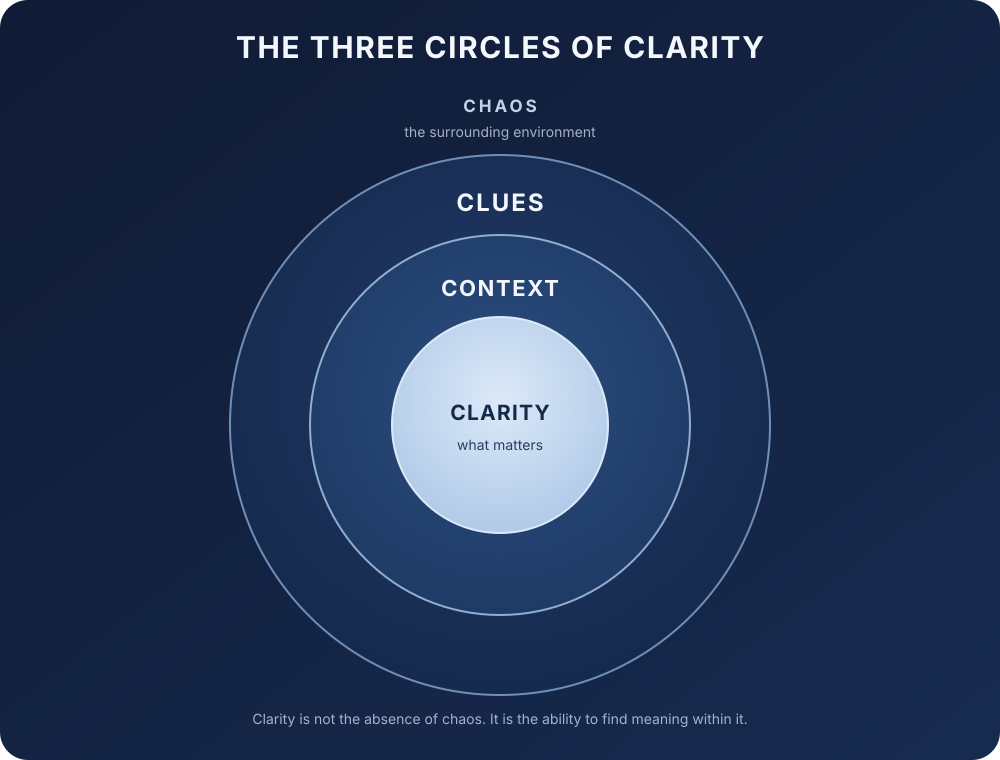

# The Three Circles of Clarity

*A personal framework for finding clarity within complexity.*

**Version 1.0**

> Chaos contains clues. Patterns reveal them. Context gives them meaning. Clarity follows.

**Chaos** is the surrounding environment. The **outer circle, Clues**, represents signals noticed through patterns. The **middle circle, Context**, connects clues to circumstances, history, goals, and constraints. At the center, **Clarity** is enough understanding to see what matters and decide what comes next.

Clarity is not the absence of chaos. It is the ability to find meaning within it.

## Origin

This personal framework grew from reflections while studying chaos theory. It is a way of thinking about human understanding, not a principle or result of mathematical chaos theory.

## In practice

During a production incident, alerts, logs, traces, and user reports can feel chaotic. Suppose repeated latency spikes begin after a deployment. The recurring pattern is a **clue**. If traces show that the spikes affect one region and converge on one downstream dependency, that **context** narrows the investigation. The resulting **clarity** is a focused next step: investigate the dependency and compare its behavior before and after the deployment. The clue points toward a question; it does not prove the cause.

## Attribution

When sharing this framework or an adaptation of it, credit **Shailendra Singh Negi**, link to [this original repository](https://github.com/shailendranegi/three-circles-of-clarity) and the [CC BY 4.0 license](https://creativecommons.org/licenses/by/4.0/), and indicate whether you made changes. Use a reasonable attribution format for the medium.

## License

This work is licensed under **CC BY 4.0**. You may share and adapt it, including for commercial purposes, provided you follow the license terms and give attribution. See [LICENSE](LICENSE) and the [official legal code](https://creativecommons.org/licenses/by/4.0/legalcode).
